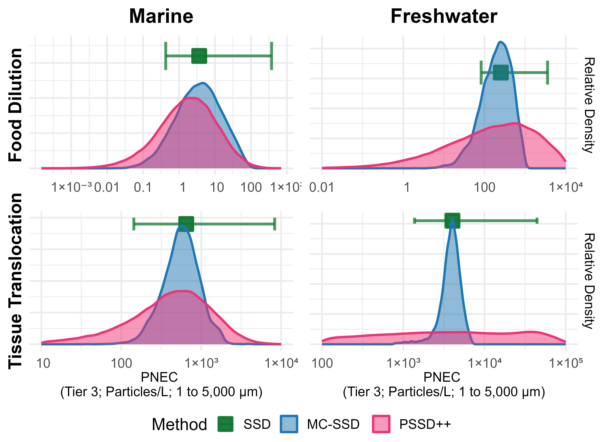
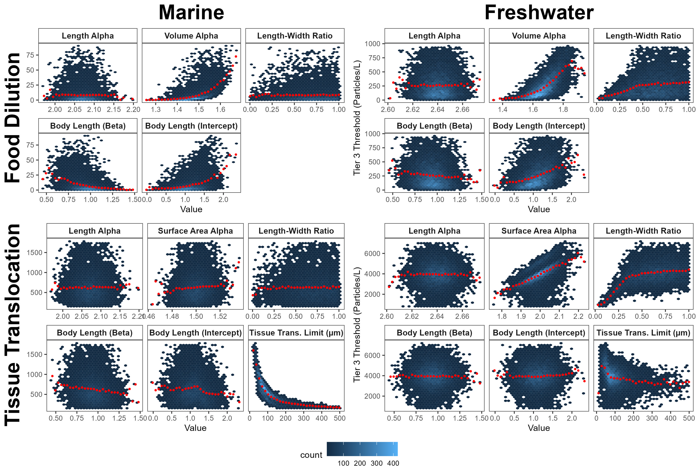
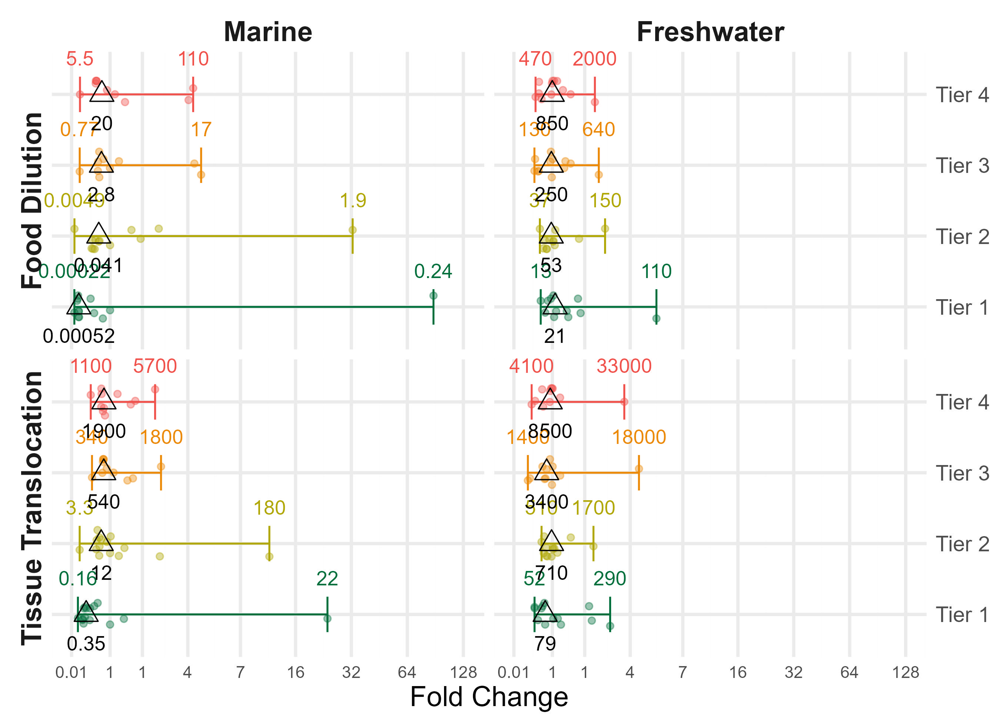

```{r setup}
suppressPackageStartupMessages({ library(dplyr); library(tidyr); library(knitr) })
here <- function(...) file.path(rprojroot::find_root("ToMEx2.0_EcoToxRisk.Rproj"), ...)
res_dir <- here("docs/correction/results")
ladder_files <- list.files(res_dir, "^ladder_nmc[0-9]+_sim[0-9]+(_[A-Z0-9-]+)?[.]rds$", full.names = TRUE)
nmc_of <- function(f) as.integer(sub(".*nmc([0-9]+)_.*", "\\1", f))
ladder <- NULL
if (length(ladder_files)) {
  # use the largest run; split production runs (one file per group of steps) are combined
  keep <- ladder_files[nmc_of(ladder_files) == max(nmc_of(ladder_files))]
  parts <- lapply(keep, readRDS)
  ladder <- parts[[1]]
  ladder$results <- bind_rows(lapply(parts, `[[`, "results")) %>% distinct(step, Tier, Environment, ERM, .keep_all = TRUE)
  ladder$run_time_min <- sum(sapply(parts, `[[`, "run_time_min"))
  vers <- sapply(parts, function(x) as.character(x$package_version))
  stp <- lapply(parts, function(x) unique(x$results$step))
  ladder$package_version <- paste(sapply(unique(vers), function(v) sprintf("%s (%s)", v,
    paste(range(unlist(stp[vers == v])), collapse = "-"))), collapse = ", ")
  ladder$date <- max(do.call(c, lapply(parts, `[[`, "date")))
}
# MC + SSD medians at full precision (the formatted table rounds them)
read_mc_medians <- function(f) {
  readRDS(f) %>% filter(Metric %in% c("Food Dilution (Default)", "Tissue Translocation (Default)")) %>%
    transmute(Environment, Tier, ERM = ifelse(grepl("Food", Metric), "FD", "TT"), value = Median, Method = "MC")
}
mcssd <- if (file.exists(file.path(res_dir, "mcssd_attribution.rds"))) readRDS(file.path(res_dir, "mcssd_attribution.rds")) else NULL
nboot <- if (file.exists(file.path(res_dir, "nboot_impact.rds"))) readRDS(file.path(res_dir, "nboot_impact.rds")) else NULL
# the attribution is final with >= 1,000 MC and 300 PSSD++ simulations; the
# corrected thresholds themselves (Table C0) come from the full production run
production <- !is.null(ladder) && ladder$n_mc >= 1000 && ladder$sim >= 300 &&
  all(paste0("S", 0:6) %in% ladder$results$step)
cov <- if (file.exists(file.path(res_dir, "cov_misjoin.rds"))) readRDS(file.path(res_dir, "cov_misjoin.rds")) else NULL
fmt <- function(x) ifelse(is.na(x), "NA", formatC(signif(x, 2), format = "fg", big.mark = ",", digits = 2))
```

::: {.callout-warning}
```{r status, results = "asis"}
if (production) {
  cat("The corrected thresholds (Table C0) are from the full production run of the analysis (9,424 Monte Carlo ",
      "and 300 PSSD++ simulations, as in the article). The stepwise attribution (Table C2) uses ",
      format(ladder$n_mc, big.mark = ","), " Monte Carlo and ", ladder$sim, " PSSD++ simulations per step, ",
      "which keeps its seven steps computationally feasible; it apportions the change between the corrections ",
      "and is not a source of corrected values.", sep = "")
} else if (!is.null(ladder)) {
  cat("**Draft.** The attribution table below was computed with a small number of simulations (",
      ladder$n_mc, " Monte Carlo, ", ladder$sim, " PSSD++) to verify the scripts. It shows the ",
      "direction and approximate size of each change, not final values. The final attribution ",
      "(1,000 Monte Carlo and 300 PSSD++ simulations per step) is listed in the ",
      "repository to-do (AGENTS.md); re-render this document when it is complete.", sep = "")
}
```
:::

## Summary

While packaging the analysis code of this article as the R package PSSDplusplus (v0.4.0, with further fixes in v0.4.1) and responding to reported issues ([ToMEx2.0_EcoToxRisk#6](https://github.com/ScottCoffin/ToMEx2.0_EcoToxRisk/issues/6), [#8](https://github.com/ScottCoffin/ToMEx2.0_EcoToxRisk/issues/8)), we found errors in the code that aligned toxicity data to the food dilution and tissue translocation ecologically relevant metrics (ERMs) in the Monte Carlo (MC) simulations, and in the preparation of the input data. These errors affect the MC + SSD and PSSD++ thresholds (Table 2, Figs. 5–7) and the record-level uncertainty statistics derived from the MC simulations. The traditional SSD thresholds are affected by the input-data errors and are corrected in the ToMEx 2.0 database and web application ([SCCWRP/ToMEx_AquaticOrganisms#5](https://github.com/SCCWRP/ToMEx_AquaticOrganisms/pull/5)).

We separate **errors** (the code did not do what the article describes) from **refinements** (corrections to individual data records that improve, but do not fix, the analysis). The corrected thresholds are given in Table C2 and the conclusions are discussed at the end of this note.

**Table C1.** Corrections, their type, and the results affected.

| ID | Correction | Type | Affects |
|---|---|---|---|
| E1 | Records without a mouth size were assumed to ingest particles up to 5 mm | Code error | Food dilution: SSD, MC + SSD, PSSD++ |
| E2 | In vitro (cell culture) records were included in SSDs | Code error | Tissue translocation (freshwater): all methods |
| E3 | Reported mouth sizes were replaced by body-length predictions | Data-preparation error | Food dilution and tissue translocation: all methods |
| E4 | Sampled body-length model coefficients were never applied | Code error | MC + SSD and PSSD++ uncertainty; Fig. 1B, Fig. 7 |
| E5 | Sampled particle shape ratios were not applied to tested particles | Code error | MC + SSD and PSSD++ (freshwater fragments) |
| E6 | Record-level MC statistics were merged to the wrong records | Code error | Intraspecies CoV statistics, CoV analyses (SI) |
| E7 | The smallest particle of polydisperse test materials lost its width; fiber widths were inconsistent | Code error | Food dilution and tissue translocation: all methods (polydisperse records, fibers) |
| E8 | Particle counts of mass-dosed tests used the database's particle geometry, not the alignment's | Code error | Food dilution and tissue translocation: all methods (mass-dosed records) |
| E9 | Conversions of the thresholds to mass, volume and surface area used the length limits as mass, volume and area limits | Code error | Thresholds in µg/L, µm³/L and µm²/L (Fig. S5, mass tables; withdrawn); not particles/L |
| E10 | SSD size filters used the midpoint length of polydisperse materials, not their bioaccessibility | Code error | MC + SSD and PSSD++ (no record in the deterministic SSDs) |
| E11 | The food dilution datasets used for the descriptive summaries were capped at the translocation limit | Code error | Dataset summaries (record, study and species counts) |
| R1 | ToMEx 2.0 database v2.0.1 and record-level body-length and in vivo / in vitro corrections | Data refinement | All methods |

## Corrected Table 2

```{r table2}
root <- here()
f_ssd <- file.path(root, "output/data/all_thresholds_combined_quality.csv")
f_mc <- file.path(root, "scripts/monte carlo/output/summary_stats_base_thresholds_sobol.rds")
f_pssd <- file.path(root, "data/output/PNEC_summary_table_wide.rds")
if (all(file.exists(c(f_ssd, f_mc, f_pssd)))) {
  published <- tribble(
    ~Environment, ~Tier, ~ERM, ~SSD, ~MC, ~PSSD,
    "Marine", "Tier1", "FD", 4.8e-5, 1.0e-5, NA,   "Marine", "Tier1", "TT", 0.82, 0.81, NA,
    "Marine", "Tier2", "FD", 2.6e-3, 2.6e-3, NA,   "Marine", "Tier2", "TT", 13, 13, NA,
    "Marine", "Tier3", "FD", 0.30, 0.28, 0.140,    "Marine", "Tier3", "TT", 490, 480, 320,
    "Marine", "Tier4", "FD", 1.5, 1.3, 0.64,       "Marine", "Tier4", "TT", 1600, 1550, 710,
    "Freshwater", "Tier1", "FD", 0.4, 0.4, NA,     "Freshwater", "Tier1", "TT", 93, 100, NA,
    "Freshwater", "Tier2", "FD", 4.9, 4.1, NA,     "Freshwater", "Tier2", "TT", 720, 710, NA,
    "Freshwater", "Tier3", "FD", 42, 36, 31,       "Freshwater", "Tier3", "TT", 4800, 4600, 2150,
    "Freshwater", "Tier4", "FD", 140, 120, 140,    "Freshwater", "Tier4", "TT", 9500, 9500, 6400) %>%
    pivot_longer(c(SSD, MC, PSSD), names_to = "Method", values_to = "published")
  ssd <- read.csv(f_ssd, check.names = FALSE, row.names = 1) %>% filter(label == "risk and tech") %>%
    transmute(Environment, Tier, FD = `Food Dilution (Default)`, TT = `Tissue Translocation (Default)`) %>%
    pivot_longer(c(FD, TT), names_to = "ERM", values_to = "corrected") %>% mutate(Method = "SSD")
  mc <- read_mc_medians(f_mc) %>% rename(corrected = value)
  ps <- readRDS(f_pssd) %>% transmute(Environment, Tier, ERM = ifelse(grepl("Food", ERM), "FD", "TT"),
                                      corrected = Median, Method = "PSSD")
  t2 <- published %>% left_join(bind_rows(ssd, mc, ps), by = c("Environment", "Tier", "ERM", "Method")) %>%
    filter(!(is.na(published) & is.na(corrected))) %>%
    mutate(Method = recode(Method, SSD = "SSD", MC = "MC + SSD", PSSD = "PSSD++"),
           fold = corrected / published,
           ERM = recode(ERM, FD = "Food dilution", TT = "Tissue translocation")) %>%
    arrange(desc(Environment), ERM, Tier, factor(Method, c("SSD", "MC + SSD", "PSSD++")))
  kable(t2 %>% transmute(Environment, ERM, Tier, Method, Published = fmt(published), Corrected = fmt(corrected),
                         `Fold change` = ifelse(is.na(fold), "", sprintf("%.2g", fold))),
        caption = "Table C0. Median thresholds (particles/L, aligned to 1-5000 um) in Table 2 as published and as corrected (all corrections E1-E11 and R1; current data and code, production run). Tier 1 is the lower 95 % confidence limit of the HC5 (see the note on bootstrap samples below). Uncertainty intervals of the corrected values are in the analysis outputs.")
}
```

## Errors

### E1. Missing mouth sizes defaulted to 5 mm

The food dilution ERM integrates the volume of ingestible particles from the lower size limit (1 µm) up to the largest particle an organism can ingest, its mouth size. For records with neither a reported mouth size nor a body length from which to predict one, the alignment code set the mouth size to the upper limit of the assessed size range (`x2D_set`, 5,000 µm). Particle volume spans about 11 orders of magnitude over 1–5,000 µm, so this assumption inflated the mean ingestible particle volume by orders of magnitude for small animals and drove their aligned food dilution concentrations, and therefore the thresholds, down. Several of the most sensitive species were affected (e.g., *Moina macrocopa*, larval *Pseudechinus huttoni*, the ciliate *Strombidium sulcatum*). Assuming that a rotifer or a ciliate ingests 5 mm particles is not defensible. These records are now excluded from the food dilution SSDs and reported; tissue translocation is unaffected. Where a body length could be documented, it was added to the database (R1), so the species are retained.

### E2. In vitro records entered the SSDs

No SSD code path filtered on the in vivo / in vitro field, so records from cell cultures (e.g., rainbow trout anterior-kidney cells; 10.1016/j.fsi.2021.04.014) entered the freshwater tissue translocation SSD. Cell cultures are not organisms and do not belong in an SSD of species sensitivities. All SSD inputs are now restricted to in vivo records. One study coded "In Vitro" in the database exposed whole live larvae (*P. huttoni*, Richardson et al. 2021) and was corrected to in vivo.

### E3. Reported mouth sizes were overwritten

The ToMEx 2.0 data preparation recomputed every mouth size from body length with the allometric model of Jâms et al. (2020), replacing the measured mouth sizes compiled in ToMEx 1.0 (Koelmans et al. 2020) for 13 species and life stages (2,769 records in v2.0.1; predicted → reported, e.g., *Danio rerio* 1.53 → 0.40 mm, adult *Daphnia magna* 0.341 → 0.115 mm, *Gammarus fossarum* 0.56 → 0.125 mm). A measured value is better evidence than a prediction, and the model is not calibrated for animals below 9 mm. Reported mouth sizes are now always used, and the model only when none is reported.

### E4. Body-length model uncertainty was not propagated

The MC simulations were described as sampling the coefficients of the body-length to mouth-size model (Fig. 1B), and their influence was shown in Fig. 7. In the code, the sampled coefficients never reached the alignment: the alignment function ignored them (ToMEx2.0_EcoToxRisk#6), and the simulation wrapper also read them under names that did not exist in the parameter matrix, so every simulation used the fixed coefficients. Any relationship between these parameters and the thresholds in Fig. 7 therefore reflects sampling noise, not an effect, and the statement in Section 3.4.1 that they "had weak negative relationships to the threshold" is withdrawn. The corrected simulations propagate the coefficient uncertainty to predicted mouth sizes only; reported (measured) mouth sizes are used as is in every simulation.

### E5. Particle-shape uncertainty did not reach tested particles

For tested fragments without a reported width, the width is estimated from the length and the length-to-width ratio (R), and the height from the width and the height-to-width ratio. The MC simulations sampled both ratios but re-aligned data that had already been aligned with the default ratios; because widths and heights are only estimated when missing, they kept their default values in every simulation. The sampled ratios therefore did not affect the tested particles (freshwater fragments: up to about 2-fold per simulation), and their influence on the freshwater thresholds in Fig. 7 was understated. Each simulation now aligns the original records.

### E6. Record-level MC statistics were merged to the wrong records

To summarise the uncertainty of each aligned toxicity value, the per-record mean, standard deviation and coefficient of variation (CoV) over the MC simulations were merged back to the records by an identifier. Because of the re-alignment in E5, the MC output numbered records 1 to *n* over the aligned subset while the record table kept the original row numbers, so the merge attached each record's statistics to a different record.

```{r cov-text, results = "asis"}
if (!is.null(cov)) cat(sprintf(
  "Of the %d records, %d received another record's statistics and %d received none. ",
  cov$n_records, cov$published_join_wrong_species, cov$published_join_unmatched))
```

The MC + SSD and PSSD++ thresholds were not affected, because they use the per-simulation values directly, but the CoV statistics were (Table C3).

### E7. Geometry of polydisperse test materials

For a polydisperse test material, the alignment needs the mean volume (food dilution) or surface area (tissue translocation) of its bioaccessible particles, computed from the smallest and the largest bioaccessible particle. The code assigned the smallest particle's width by matching the shape names in lower case ("sphere", "fiber", "fragment"), whereas the database codes them capitalised, and had no fallback. The width was therefore lost for every polydisperse sphere, fiber and fragment and later filled with the length-to-width ratio of fragments, so the smallest sphere was treated as an ellipsoid (volume 0.67 of the sphere's in freshwater, 0.77 in marine waters), and the smallest particle's height used a fixed 0.67 × width rather than the environment's (or the sampled) height-to-width ratio (fragment volume 0.87 of the intended value in marine waters). For fibers, the largest bioaccessible particle kept the database width, which is the length-to-width ratio times the *untruncated* maximum length, so a partially ingestible fiber could be several times wider than long. Fibers now have one diameter at both ends (reported width, else 15 µm), never more than their length; the 15 µm default is also capped at the length for monodisperse fibers (2 SSD records were shorter than 15 µm). The 15 µm value is the fiber diameter used to classify fibers in the environmental data of Kooi et al. (2021, Section 3.2), not a measured mean width. Other monodisperse records are unaffected. This error was found after v0.4.0 and is fixed in v0.4.1.

### E8. Particle counts of tests dosed by mass

Most studies report their dose as a mass concentration; the database converts it to a particle concentration with a mean particle mass. That conversion used the database's own particle geometry (a fixed height-to-width ratio of 0.67, and a polydisperse material treated as a single particle of the midpoint length; some ToMEx 1.0 conversions match neither), whereas the alignment then built the same particles with its own geometry and size distribution. The aligned volume (or mass) dose was therefore not the dosed mass divided by the polymer density. The alignment now recomputes the particle concentration of every mass-dosed test as the dosed mass divided by the mean particle mass under its own geometry and size distribution (for a polydisperse material, the power-law mean over the whole reported size range), so the aligned particles carry exactly the dosed mass. Reported particle concentrations are used as reported. (PSSDplusplus v0.4.1: `align_data(particle_count_source = "mass")`, the default; `"database"` reproduces the earlier counts.)

### E9. Conversion of the thresholds to mass, volume and surface area

The particle-based thresholds were converted to µg/L, µm³/L and µm²/L (Fig. S5 and the mass-based tables) by multiplying them by the mean particle mass, volume or surface area of the environmental size distribution between 1 and 5,000 µm. The code passed the length limits (1 and 5,000) as if they were the mass, volume and surface-area limits of the distribution. The correct limits are the mass, volume and surface area of 1 µm and 5,000 µm particles, as in the worked example of Kooi et al. (2021, Supplementary Information). The published thresholds in mass, volume and surface-area units are therefore incorrect and are withdrawn; the thresholds in particles/L are unaffected.

The corrected conversion is dimensionally consistent, but its result is not robust enough to replace them:

- **It extrapolates the fitted power laws far beyond their fitted ranges.** The mean particle mass over 1 to 5,000 µm is set by exponents that Kooi et al. (2021) fitted over much narrower ranges. For example, the freshwater surface-water mass distribution was fitted only above 18 µg, a sphere of about 320 µm.
- **It depends strongly on assumptions.** Depending on which exponent (length, volume or mass) and which particle shape is used, the mean mass is about 0.001–0.008 µg per particle in freshwater and 0.1–10 µg in marine waters. By contrast, the measured mean masses of the particles analysed by Kooi et al. (2021, Table S3) are similar in both: 8.4 µg (freshwater) and 12.1 µg (marine), for particles of at least 11–20 µm.
- **Recent work points to better practice.** Zhao et al. (2026) restrict such power laws to the empirically supported size range (10–5,000 µm). Chen et al. (2026) show that particle shapes whose height scales with length overestimate the mass of large particles.

A conversion method that addresses these issues will be developed separately. Until then, no corrected thresholds in mass, volume or surface-area units are given. PSSDplusplus v0.4.1 and the ToMEx web application retain the corrected conversion for indicative use only.

References: Kooi, M., et al. (2021). *Water Research* 202, 117429. Zhao, B., et al. (2026). *Water Research* 299, 125833. Chen, H., et al. (2026). *Environmental Science & Technology* 60, 1263–1274.

### E10. Size filters of the SSD inputs

The SSD inputs were filtered on the midpoint length of each record (e.g. at most the translocation limit for tissue translocation), whereas the method uses the bioaccessible fraction of each polydisperse test material (Supplementary Information): a partially bioaccessible material whose midpoint exceeds the limit was dropped. The inputs are now selected by the bioaccessibility labels, with only the lower size limit applied to the length. No record of the deterministic SSDs changes, but Monte Carlo draws of the mouth size do.

### E11. Descriptive summaries of the food dilution datasets

The food dilution datasets summarised in the PSSD++ section of the analysis (record, study and species counts) and saved for other scripts (`tier1_2_food.RDS`, `tier3_4_food.RDS`) were capped at the translocation limit (88 µm) instead of the ingestible size. They are now selected as in E10. The thresholds were not affected.

```{r e7-table}
v040 <- here("docs/correction/results/v0.4.0_production")
f_new <- c(SSD = here("output/data/all_thresholds_combined_quality.csv"),
           MC = here("scripts/monte carlo/output/summary_stats_base_thresholds_sobol.rds"),
           PSSD = here("data/output/PNEC_summary_table_wide.rds"))
f_old <- c(SSD = file.path(v040, "all_thresholds_combined_quality.csv"),
           MC = file.path(v040, "summary_stats_base_thresholds_sobol.rds"),
           PSSD = file.path(v040, "PNEC_summary_table_wide.rds"))
read_thr <- function(f) {
  ssd <- read.csv(f["SSD"], check.names = FALSE, row.names = 1) %>% filter(label == "risk and tech") %>%
    transmute(Environment, Tier, FD = `Food Dilution (Default)`, TT = `Tissue Translocation (Default)`) %>%
    pivot_longer(c(FD, TT), names_to = "ERM", values_to = "value") %>% mutate(Method = "SSD")
  mc <- read_mc_medians(f["MC"])
  ps <- readRDS(f["PSSD"]) %>% transmute(Environment, Tier, ERM = ifelse(grepl("Food", ERM), "FD", "TT"), value = Median, Method = "PSSD")
  bind_rows(ssd, mc, ps)
}
if (all(file.exists(c(f_new, f_old)))) {
  e7 <- inner_join(read_thr(f_old), read_thr(f_new), by = c("Environment", "Tier", "ERM", "Method"), suffix = c(".old", ".new")) %>%
    mutate(ratio = value.new / value.old,
           Method = recode(Method, SSD = "SSD", MC = "MC + SSD", PSSD = "PSSD++"),
           ERM = recode(ERM, FD = "Food dilution", TT = "Tissue translocation")) %>%
    select(Environment, ERM, Tier, Method, ratio) %>%
    pivot_wider(names_from = Method, values_from = ratio) %>%
    arrange(desc(Environment), ERM, Tier) %>%
    mutate(across(where(is.numeric), ~ ifelse(is.na(.x), "", sprintf("%.2f", .x))))
  kable(e7, caption = "Table C6. Effect of E7-E11 together: ratio of the production thresholds with PSSDplusplus v0.4.1 to those with v0.4.0 (same data, parameter matrix and seeds; E1-E6 and R1 applied in both).")
}
```

## Refinements

### R1. Database v2.0.1 and record-level corrections

The ToMEx 2.0 database was updated to release v2.0.1 (30 June 2026), which corrected individual records (e.g., life stages, exposure durations, effect metrics). In addition, body lengths that were not those of the tested animals were corrected at record level from the original studies, each with an evidence tier (A, measured in the study; B, derived from the study; C, imputed): e.g., *Pinctada margaritifera* 9.8 → 5.9 cm, *Mytilus galloprovincialis* 15 → 5.0–6.54 cm, larval *Crepidula onyx* 6 → 0.0624 cm, *Moina macrocopa* added (0.1665 cm), *P. huttoni* added (0.0478 cm). Body lengths are applied only to the life stage they describe and are never set to a default. These changes are listed with sources in the database repository and in PR #5.

## Impact on the PSSD++ thresholds

Starting from the published configuration, each step below adds one correction and re-runs the MC alignment and PSSD++ with the same parameter matrix and random seeds, so the change between consecutive steps is attributable to that correction. All steps use the log-normal approximation of the species-level distributions described in the Supplementary Information, as in the published analysis.

```{r ladder-table}
if (!is.null(ladder)) {
  published <- tribble(
    ~Tier, ~Environment, ~ERM, ~Median, ~Q5, ~Q95,
    "Tier3", "Marine", "Food Dilution", 0.140, 0.01, 1.2,
    "Tier3", "Marine", "Tissue Translocation", 320, 74, 1400,
    "Tier3", "Freshwater", "Food Dilution", 31, 0.14, 1500,
    "Tier3", "Freshwater", "Tissue Translocation", 2150, 167, 38000,
    "Tier4", "Marine", "Food Dilution", 0.64, 0.081, 5.0,
    "Tier4", "Marine", "Tissue Translocation", 710, 190, 2500,
    "Tier4", "Freshwater", "Food Dilution", 140, 6.3, 1800,
    "Tier4", "Freshwater", "Tissue Translocation", 6400, 420, 56000)
  wide <- ladder$results %>%
    mutate(col = paste(Environment, ifelse(ERM == "Food Dilution", "FD", "TT"))) %>%
    select(step, label, category, Tier, col, Median) %>%
    pivot_wider(names_from = col, values_from = Median) %>%
    arrange(Tier, step)
  pub_row <- published %>% mutate(col = paste(Environment, ifelse(ERM == "Food Dilution", "FD", "TT"))) %>%
    select(Tier, col, Median) %>% pivot_wider(names_from = col, values_from = Median) %>%
    mutate(step = "Table 2", label = "Published value", category = "")
  tab <- bind_rows(pub_row, wide) %>% arrange(Tier, step != "Table 2", step) %>%
    mutate(across(c(starts_with("Marine"), starts_with("Freshwater")), fmt)) %>%
    select(Tier, Step = step, Change = label, Type = category,
           `Marine FD` = `Marine FD`, `Marine TT` = `Marine TT`,
           `Freshwater FD` = `Freshwater FD`, `Freshwater TT` = `Freshwater TT`)
  kable(tab, caption = sprintf(
    "Table C2. Median PSSD++ thresholds (particles/L; Tier 3 = HC5, Tier 4 = HC10) after each correction. FD = food dilution, TT = tissue translocation. %s",
    if (production) "" else "Draft values from a reduced number of simulations."))
}
```

```{r s0-check, results = "asis"}
if (!is.null(ladder)) {
  s0 <- ladder$results %>% filter(step == "S0") %>% inner_join(published, by = c("Tier", "Environment", "ERM"), suffix = c("", ".pub"))
  rr <- s0$Median / s0$Median.pub
  cat(sprintf(paste0("**Check of the baseline.** Step S0 reproduces the published PSSD++ medians to within a factor of %.2f-%.2f ",
                     "(median ratio %.2f) across the eight thresholds%s, which confirms that the attribution starts from the published analysis.\n\n"),
              min(rr), max(rr), median(rr), if (production) "" else " despite the reduced number of simulations"))
  full_files <- list.files(file.path(res_dir, "fullsize_check"), "^ladder_nmc[0-9]+_sim300_S[0-9]+[.]rds$", full.names = TRUE)
  if (length(full_files)) {
    full <- bind_rows(lapply(full_files, function(f) readRDS(f)$results))
    chk <- inner_join(full, ladder$results, by = c("step", "Tier", "Environment", "ERM"), suffix = c(".full", ".att"))
    cat(sprintf(paste0("**Check of the reduced simulation count.** Steps %s were also run with the full 9,424 Monte Carlo ",
                       "simulations; the %d medians agree with the %s-simulation results to within %.0f%% (median difference %.0f%%).\n\n"),
                paste(sort(unique(chk$step)), collapse = ", "), nrow(chk), format(ladder$n_mc, big.mark = ","),
                100 * max(abs(chk$Median.att / chk$Median.full - 1)), 100 * median(abs(chk$Median.att / chk$Median.full - 1))))
  }
  f_render <- here("data/output/PNEC_summary_table_wide.rds")
  last_step <- max(ladder$results$step)
  if (file.exists(f_render) && last_step %in% c("S6", "S7", "S8")) {
    rr6 <- ladder$results %>% filter(step == last_step) %>%
      inner_join(readRDS(f_render) %>% select(Tier, Environment, ERM, Median), by = c("Tier", "Environment", "ERM"),
                 suffix = c("", ".render"))
    cat(sprintf(paste0("**Check of the end point.** The fully corrected step (%s) reproduces the medians of the production ",
                       "run of the analysis (Table C0) to within %.0f%% (median difference %.0f%%).\n\n"), last_step,
                100 * max(abs(rr6$Median / rr6$Median.render - 1)), 100 * median(abs(rr6$Median / rr6$Median.render - 1))))
  }
  cat(paste0("**Notes.** In vitro exclusion (S2) changes the PSSD++ thresholds only through *P. huttoni*, which the database ",
             "then coded as in vitro; the rainbow trout cell-culture records do not reach Tiers 3 and 4, which require organism- or ",
             "population-level endpoints. The record is corrected to in vivo in R1 (S4). Propagating particle-shape uncertainty (S6) ",
             "changes the aligned values of freshwater fragments, which are mostly not among the most sensitive species. ",
             "In steps S1-S3 the freshwater food dilution Tier 3 and Tier 4 values are equal: removing the 5 mm default leaves ",
             "six freshwater species with a known mouth size, too few for the HC5 and HC10 to differ (see the note on the ",
             "quantile method below); the record-level corrections in R1 (S4) restore eight species.\n"))
}
```

```{r ladder-ratios}
if (!is.null(ladder)) {
  r <- ladder$results %>% arrange(step) %>%
    group_by(Tier, Environment, ERM) %>%
    mutate(fold = Median / lag(Median)) %>% ungroup() %>% filter(step != "S0") %>%
    mutate(col = paste(Environment, ifelse(ERM == "Food Dilution", "FD", "TT"))) %>%
    select(Tier, step, label, col, fold) %>% pivot_wider(names_from = col, values_from = fold) %>%
    arrange(Tier, step) %>% mutate(across(where(is.numeric), ~ sprintf("%.2f", .x)))
  kable(r, caption = "Fold change of the median threshold caused by each step (relative to the previous step).")
}
```

Fixing the particle geometry and the size filters (S7; E7, E10) raises the food dilution thresholds by 1–15 % and changes the tissue translocation thresholds by −4 to +13 %. Recomputing the particle counts of mass-dosed tests from the dosed mass (S8; E8) lowers the freshwater thresholds by 5–10 % and leaves the marine thresholds unchanged (within 1 %).

## Impact of E4 and E5 on the MC + SSD thresholds

```{r mcssd}
if (!is.null(mcssd)) {
  m <- mcssd$summary %>% mutate(cfg = case_when(
      coef == "fixed" & shape == "frozen" ~ "As published",
      coef == "sampled" & shape == "frozen" ~ "+ E4",
      coef == "fixed" & shape == "propagated" ~ "+ E5",
      TRUE ~ "+ E4 + E5"),
    col = paste(environment, ERM)) %>%
    select(Tier, cfg, col, median) %>% pivot_wider(names_from = col, values_from = median) %>%
    mutate(cfg = factor(cfg, c("As published", "+ E4", "+ E5", "+ E4 + E5"))) %>% arrange(Tier, cfg) %>%
    mutate(across(where(is.numeric), fmt))
  kable(m, col.names = c("Tier", "Simulations", names(m)[-(1:2)]),
        caption = sprintf("Table C5. Median MC + SSD thresholds (particles/L) over %d randomly drawn Monte Carlo simulations with the current data, with the body-length coefficients fixed or sampled (E4) and particle shape frozen at the default ratios or propagated (E5).", mcssd$k_sims))
}
```

Propagating body-length and particle-shape uncertainty changes the median MC + SSD thresholds only modestly; the largest changes are in the marine thresholds (E4), where many species have predicted mouth sizes. The other corrections (E1-E3, R1) change the MC + SSD thresholds as they change the traditional SSD thresholds.

## Impact on the intraspecies coefficients of variation

```{r cov-table}
if (!is.null(cov)) {
  kable(cov$summary %>% mutate(across(c(min, median, max), ~ signif(.x, 2))) %>%
          select(Join = join, Environment = environment, ERM, `Records` = n, Min = min, Median = median, Max = max),
        caption = "Table C3. Coefficient of variation of the aligned toxicity values over the published MC simulations, by record, merged as published and to the correct records.")
  kable(cov$spearman %>% mutate(rho = round(rho, 2), p = signif(p, 2)) %>% select(Join = join, ERM, `Spearman rho (CoV vs mouth size)` = rho, p),
        caption = "Spearman correlation between the coefficient of variation and the mouth size of the tested species.")
}
```

```{r cov-range, results = "asis"}
if (!is.null(cov)) {
  cat(sprintf(
    "Correcting the merge alone leaves the overall range of the coefficients of variation (%.2f–%.1f) stated in Section 2.4.2 unchanged, because it permuted the values among records rather than changing them; the statistics by environment and ERM, and the association with mouth size, change as shown. ",
    cov$range_all$min[2], cov$range_all$max[2]))
  if (nrow(cov$range_all) >= 3) cat(sprintf(
    "With the corrected simulations (E4, E5), which propagate body-length and particle-shape uncertainty, the coefficients of variation range from %.2f to %.1f; the sentence in Section 2.4.2 should read \"between %.2f and %.1f\".",
    cov$range_all$min[3], cov$range_all$max[3], cov$range_all$min[3], cov$range_all$max[3]))
}
```

## Related issues outside PSSD++

### Number of bootstrap samples (Tier 1 and SSD confidence intervals)

Tier 1 is the lower 95 % confidence limit of the HC5, and the SSD thresholds in Table 2 carry 95 % bootstrap intervals; both were estimated from 10 bootstrap samples, as in the ToMEx 2.0 web application. HC point estimates (Tiers 2–4 and all MC + SSD medians except Tier 1) do not depend on the number of bootstrap samples. Repeating the MC + SSD analysis with 1,000 samples is computationally prohibitive, and the thresholds are not re-estimated; instead we tested the effect of 10 versus 1,000 samples directly (`docs/correction/R/nboot_impact.R`).

```{r nboot-det}
if (!is.null(nboot)) {
  d <- nboot$deterministic %>% mutate(ERM = ifelse(grepl("Tissue", metric), "TT", "FD"),
                                       stat = case_when(grepl("Default", metric) ~ "value", grepl("95th", metric) ~ "upper", grepl("5th", metric) ~ "lower")) %>%
    select(environment, Tier, ERM, stat, nboot, value) %>%
    pivot_wider(names_from = nboot, values_from = value, names_prefix = "n") %>%
    mutate(ratio = n1000 / n10)
  kable(d %>% filter(!(Tier == "Tier1" & stat != "value")) %>% arrange(environment, ERM, Tier, stat) %>%
          mutate(n10 = fmt(n10), n1000 = fmt(n1000), ratio = sprintf("%.2f", ratio)) %>%
          select(Environment = environment, ERM, Tier, Statistic = stat, `nboot = 10` = n10, `nboot = 1000` = n1000, Ratio = ratio),
        caption = "Table C4. Traditional SSD thresholds (particles/L; current data and code) with 10 and 1,000 bootstrap samples (seed 99). 'value' is the threshold (Tier 1 = lower confidence limit of the HC5; Tiers 2-4 = HC point estimates); 'lower'/'upper' are the bounds of the 95 % interval.")
}
```

```{r nboot-seed, results = "asis"}
if (!is.null(nboot)) {
  sp <- nboot$seed_spread %>% group_by(environment, ERM) %>%
    summarise(lo = min(t1_nboot10), hi = max(t1_nboot10), .groups = "drop") %>% mutate(fold = hi / lo)
  t1d <- nboot$deterministic %>% filter(Tier == "Tier1", grepl("Default", metric)) %>%
    mutate(ERM = ifelse(grepl("Tissue", metric), "TT", "FD")) %>% select(environment, ERM, nboot, value) %>%
    pivot_wider(names_from = nboot, values_from = value, names_prefix = "n")
  cat(sprintf("With 10 bootstrap samples, the Tier 1 threshold depends strongly on the random seed: across 20 seeds it varied %s-fold. ",
              paste(sprintf("%.1f", range(sp$fold)), collapse = "- to ")))
  cat("For the seed used in the analysis, the Tier 1 values with 1,000 samples were ",
      paste(sprintf("%s %s %s → %s", t1d$environment, t1d$ERM, fmt(t1d$n10), fmt(t1d$n1000)), collapse = "; "),
      " particles/L.\n\n", sep = "")
}
if (!is.null(nboot)) {
  m <- nboot$mc %>% mutate(ratio = t1_nboot1000 / t1_nboot10)
  ms <- m %>% group_by(environment, ERM) %>%
    summarise(med10 = median(t1_nboot10, na.rm = TRUE), med1000 = median(t1_nboot1000, na.rm = TRUE),
              lo_ratio = quantile(ratio, 0.05, na.rm = TRUE), hi_ratio = quantile(ratio, 0.95, na.rm = TRUE), .groups = "drop")
  cat(sprintf("For MC + SSD, Tier 1 was recomputed with 10 and 1,000 bootstrap samples for %d randomly drawn Monte Carlo simulations (paired). ", nboot$k_sims))
  cat("The median Tier 1 over these simulations changed from ",
      paste(sprintf("%s %s %s → %s", ms$environment, ms$ERM, fmt(ms$med10), fmt(ms$med1000)), collapse = "; "),
      " particles/L; per simulation the ratio (1,000/10 samples) ranged ",
      paste(sprintf("%.2f–%.2f (%s %s)", ms$lo_ratio, ms$hi_ratio, ms$environment, ms$ERM), collapse = ", "),
      " (5th–95th percentiles).\n\n", sep = "")
}
```

Ten bootstrap samples have two consequences. The limits are noisy, which matters for a single (traditional) SSD; for MC + SSD this noise largely averages out in the median over thousands of simulations. They are also biased: a 95 % interval from 10 values is bounded by the most extreme of only 10 draws and cannot reach into the tails, so lower limits tend to be too high, i.e. less protective. This bias does not average out over simulations. Tier 1 thresholds (traditional SSD and MC + SSD) and the lower bounds of the SSD intervals in Table 2 should therefore be read as upper estimates; HC point estimates (Tiers 2–4) are unaffected. The analysis keeps 10 bootstrap samples, consistent with the ToMEx 2.0 web application.

### Quantile method for the PSSD++ HCx (Supplementary Information)

The Supplementary Information states that using quantile type 8 instead of type 1 "ensures that distinct values are produced for every HCx (e.g., HC5, HC10), even with limited data". This holds only above a minimum number of species. With *n* species, type 8 places the *p*th quantile at rank (*n* + ⅓)*p* + ⅓, and ranks below 1 return the most sensitive species: the HC10 equals the HC5 (both the most sensitive species) when there are six or fewer species, and the HC5 equals the most sensitive species' value in each simulation when there are 13 or fewer. The Tier 3 and 4 PSSD++ thresholds are based on 7–13 species per environment and ERM, so their HC5 values are effectively those of the most sensitive species, while the HC10 values differ from them. The method is unchanged.

### Version of ssdtools

 The SSDs were fitted with ssdtools 0.3.7, as stated. Later versions (≥ 2.0) average the fitted distributions differently by default (the HC5 of the model-averaged mixture distribution, rather than the weighted mean of each distribution's HC5), which lowers Tier 2–4 HC5s for these data by 0–47 %; with the earlier averaging they reproduce our values to within 1 %. This is a change of method in ssdtools, not an error in the version we used, and the thresholds are not changed on that account.

## Effect on the conclusions

The corrections change the food dilution thresholds substantially and the tissue translocation thresholds little (Table C0). Food dilution thresholds increase for every method, tier and environment: by about 5- to 50-fold in freshwater and 12- to 60-fold in marine waters (more for the marine MC + SSD Tier 1 value). The published food dilution thresholds were therefore too low, i.e. more protective than the data support. The largest contribution is the removal of the 5 mm default ingestible size for organisms without a mouth size (E1), which had assigned the most sensitive small species very low aligned effect concentrations (about 21-fold in freshwater and 4-fold in marine waters at Tier 3; Table C2). The database refinements (R1) partly offset this in freshwater, where documented body lengths return sensitive species such as *Moina macrocopa* to the food dilution SSD, and increase the marine values; the other corrections change the PSSD++ thresholds by up to about 30 % (the particle-geometry and particle-count corrections E7, E8 and E10 together by 0.88- to 1.15-fold; Table C2). Tissue translocation thresholds change by less than 2-fold.

Most qualitative conclusions are unchanged: marine thresholds remain lower than freshwater thresholds, and food dilution thresholds remain lower than tissue translocation thresholds, for all tiers and methods. Two comparisons between methods change in degree. Traditional SSD and MC + SSD medians are within about 10–20 % of each other at Tiers 3 and 4, but up to about 45 % apart in marine waters at Tiers 1 and 2 (e.g. marine tissue translocation Tier 1: 0.94 vs 0.65 particles/L), because the MC + SSD now propagates the uncertainty of predicted mouth sizes (E4). PSSD++ gives the lowest median in six of the eight Tier 3 and 4 cases rather than all; the exceptions are freshwater food dilution Tier 4 (essentially equal to MC + SSD) and freshwater tissue translocation Tier 4 (12,400 vs 9,000–9,100 particles/L). Statements that quote threshold values or ratios, in particular for food dilution (e.g. the range "1 × 10⁻⁵ to 137 particles/L" and "PSSD++ thresholds were consistently lower by up to 2-fold" in Section 3.3, the marine-to-freshwater ratios in Section 3.4.2, and "0.5–2.5 orders of magnitude" in Section 4.3.3), should be replaced with values from the corrected results. Risk characterisations that used the published food dilution thresholds overstate the risk from food dilution by the factors in Table C0. The published thresholds expressed as mass, volume or surface-area concentrations (Fig. S5 and the mass-based tables) are withdrawn (E9); no corrected values in these units are given.

## Changes to the published article, item by item

This section lists every table, figure and statement of the article and its Supplementary Information whose content changes, with the corrected value or text. Corrected values come from the production run of the corrected analysis (PSSDplusplus v0.4.1). Published values are those printed in the article; where a statistic is not printed, it comes from the outputs of the published analysis (December 2025), which reproduce the printed SSD and MC + SSD values of Table 2 and Table S5 (`docs/correction/R/article_items.R`). Statements that are not listed are unchanged.

```{r items-setup}
items <- readRDS(here("docs/correction/results/article_items.rds"))
s_pub <- items$statements$pub
s_cor <- items$statements$corr
f2 <- function(x) trimws(formatC(signif(x, 2), format = "fg", big.mark = ",", digits = 2))
rng <- function(x) paste(f2(x[1]), "to", f2(x[2]))
pc <- function(x) sprintf("%.0f %%", 100 * x)
num <- function(x) as.numeric(gsub(",", "", sub(" .*", "", x)))
```

### Highlights and Abstract

```{r items-abstract, results = "asis"}
env_sens <- items$envsens$corr
names(env_sens) <- c("Tier", "FW_sp_mar_FD", "FW_sp_mar_TT", "FW_sp_FW_FD", "FW_sp_FW_TT",
                     "Mar_sp_FW_FD", "Mar_sp_FW_TT", "Mar_sp_mar_FD", "Mar_sp_mar_TT")
es <- env_sens %>% mutate(across(-Tier, num))
param_effect <- c(es$Mar_sp_FW_FD / es$Mar_sp_mar_FD, es$Mar_sp_FW_TT / es$Mar_sp_mar_TT,
                  es$FW_sp_FW_FD / es$FW_sp_mar_FD, es$FW_sp_FW_TT / es$FW_sp_mar_TT)
param_effect <- param_effect[is.finite(param_effect)]
cat(sprintf(paste0(
  "- *\"PSSD++ consistently produced the most health-protective median thresholds and lowest 5th-percentile values\"* (Abstract; also Highlights, Sections 3.3 and 5). ",
  "PSSD++ gives the lowest median in %d of the 8 Tier 3 and 4 cases (the published values: %d of 8) and the lowest 5th percentile in %d of 8. ",
  "Corrected text: \"PSSD++ produced the most health-protective median thresholds in most cases and the lowest 5th-percentile values\".\n"),
  s_cor$n_pssd_lowest_median, s_pub$n_pssd_lowest_median, s_cor$n_pssd_lowest_q5))
cat(sprintf(paste0(
  "- *\"Uncertainty was greater for food dilution than for tissue translocation, and greater for freshwater environments than marine\"*: unchanged for the PSSD++ relative confidence intervals (RCIs; Table S10 below). ",
  "For the MC + SSD relative standard deviations (Table S5), freshwater thresholds vary less than marine ones, as stated in the Supplementary Information.\n")))
cat(sprintf(paste0(
  "- *\"ERM-alignment parameters ... contributing up to two orders of magnitude difference\"*: applying the other environment's alignment parameters changes the corrected Tier 2-4 thresholds by %s-fold, i.e. up to about %.1f orders of magnitude (Section 3.4.2 below).\n"),
  rng(range(param_effect)), log10(max(param_effect))))
```

### Section 3.1.1 (database coverage) and Table S1

The numbers of data points, studies and species used in the thresholds change with E1-E3 and R1 (Table C7). In the text, "16 studies for freshwater species (10 species; 140 data points), and 16 studies for marine species (17 species; 235 data points)" and the percentages of chronic data and of data requiring uncertainty factors should be replaced with the corrected values; the taxa listed in Section 3.1.1 follow the corrected species lists (e.g., the in vitro rainbow trout records are removed; *Moina macrocopa*, *Pseudechinus huttoni* and *Centropristis striata* are included).

```{r items-db}
db_rows <- c("Number of Data Points", "Number of Studies", "Number of Species", "% Chronic")
dbt <- function(d, v) d %>% filter(Factor %in% db_rows) %>%
  select(Factor, `Freshwater (Tier 1/2)`, `Freshwater (Tier 3/4)`, `Marine (Tier 1/2)`, `Marine (Tier 3/4)`) %>%
  mutate(Version = v)
uf <- function(d, v) {
  g <- function(col) { x <- suppressWarnings(as.numeric(d[[col]])); names(x) <- d$Factor
    sum(x[c("UF:2", "UF:10", "UF:20", "UF:100")], na.rm = TRUE) / x["Number of Data Points"] }
  tibble(Factor = "% requiring an uncertainty factor of 2-100",
         `Freshwater (Tier 1/2)` = pc(g("Freshwater (Tier 1/2)")), `Freshwater (Tier 3/4)` = pc(g("Freshwater (Tier 3/4)")),
         `Marine (Tier 1/2)` = pc(g("Marine (Tier 1/2)")), `Marine (Tier 3/4)` = pc(g("Marine (Tier 3/4)")), Version = v)
}
db <- bind_rows(dbt(items$dbsum$pub, "published"), uf(items$dbsum$pub, "published"),
                dbt(items$dbsum$corr, "corrected"), uf(items$dbsum$corr, "corrected")) %>%
  mutate(across(everything(), as.character)) %>% arrange(factor(Factor, c(db_rows, "% requiring an uncertainty factor of 2-100")), desc(Version))
kable(db, caption = "Table C7. Data used in the thresholds (Section 3.1.1, Table S1), by environment and tier group, in the published and the corrected analysis.")
```

### Table 2 and Section 3.3

Table 2 is replaced by Table C8, which gives the corrected medians with their 95 % intervals (summary in Table C0).

```{r items-table2}
t2 <- items$table2 %>%
  mutate(Method = recode(Method, SSD = "SSD", MC = "MC + SSD", PSSD = "PSSD++"),
         ERM = recode(ERM, FD = "Food dilution", TT = "Tissue translocation"),
         Published = ifelse(is.na(lower.pub), f2(median.pub), sprintf("%s (%s-%s)", f2(median.pub), f2(lower.pub), f2(upper.pub))),
         Corrected = ifelse(is.na(lower.corr), f2(median.corr), sprintf("%s (%s-%s)", f2(median.corr), f2(lower.corr), f2(upper.corr)))) %>%
  select(Environment, ERM, Tier, Method, Published, Corrected)
kable(t2, caption = "Table C8. Corrected Table 2: median thresholds (particles/L, aligned to 1-5000 um) with 95 % intervals (SSD: bootstrap; MC + SSD: 5th-95th percentiles over the simulations; PSSD++: 5th-95th percentiles). Tier 1 SSD values are themselves lower confidence limits.")
```

```{r items-33, results = "asis"}
w34 <- items$table2 %>% filter(Tier >= 3) %>% select(Environment, ERM, Tier, Method, median.corr) %>%
  pivot_wider(names_from = Method, values_from = median.corr) %>% mutate(r = PSSD / pmin(SSD, MC))
lab <- function(d) paste(sprintf("%s %s Tier %d (%.2f-fold)", tolower(d$Environment),
  ifelse(d$ERM == "FD", "food dilution", "tissue translocation"), d$Tier, d$r), collapse = " and ")
higher_txt <- if (any(w34$r > 1)) lab(w34 %>% filter(r > 1)) else "none"
wid <- s_cor$widest_rci %>% filter(widest != "SSD")
widest_txt <- if (nrow(wid)) paste(sprintf("Tier %d %s %s", wid$Tier, tolower(wid$Environment),
  ifelse(wid$ERM == "FD", "food dilution", "tissue translocation")), collapse = " and ") else "no case"
cat(sprintf(paste0(
  "- *\"ranged from 1 x 10^-5^ to 137 particles/L for food dilution, and from 0.81 to 9510 particles/L for tissue translocation\"*: corrected, %s particles/L for food dilution and %s particles/L for tissue translocation.\n",
  "- *\"SSD and MC + SSD results were within 20 %% of one another\"*: corrected, within %s at Tiers 3 and 4 and %s across all tiers.\n",
  "- *\"PSSD++ thresholds were consistently lower by up to 2-fold\"*: corrected, the PSSD++ medians are %s times the lower of the SSD and MC + SSD medians at Tiers 3 and 4: lower in %d of the 8 cases (by up to %s-fold) and higher in %s.\n",
  "- *\"SSD-derived thresholds exhibited the widest relative confidence intervals (RCIs), except for Tier 3 freshwater food dilution\"*: corrected, SSD has the widest RCI except for %s (PSSD++; Table C9). The 5th percentile is lowest for PSSD++ in %d of the 8 Tier 3 and 4 cases.\n",
  "- *\"Freshwater thresholds had higher RCIs (8-59) than marine thresholds (3-9) ... food dilution thresholds had higher uncertainty (RCIs: 8-59) than tissue translocation thresholds (RCIs: 3-18)\"* (PSSD++): corrected RCIs are %s (freshwater) and %s (marine), and %s (food dilution) and %s (tissue translocation). Tier 4 RCIs remain lower than Tier 3 RCIs in every case.\n"),
  rng(s_cor$range_FD), rng(s_cor$range_TT), pc(max(s_cor$ssd_vs_mc_34)), pc(max(s_cor$ssd_vs_mc, na.rm = TRUE)),
  rng(range(s_cor$pssd_vs_min)), sum(s_cor$pssd_vs_min < 1), f2(1 / min(s_cor$pssd_vs_min)), higher_txt, widest_txt,
  s_cor$n_pssd_lowest_q5,
  rng(range(s_cor$rci_pssd$rci[s_cor$rci_pssd$Environment == "Freshwater"])),
  rng(range(s_cor$rci_pssd$rci[s_cor$rci_pssd$Environment == "Marine"])),
  rng(range(s_cor$rci_pssd$rci[s_cor$rci_pssd$ERM == "FD"])), rng(range(s_cor$rci_pssd$rci[s_cor$rci_pssd$ERM == "TT"]))))
```

```{r items-s10}
s10 <- items$table2 %>% filter(Tier >= 2) %>%
  mutate(Method = recode(Method, SSD = "SSD", MC = "MC + SSD", PSSD = "PSSD++"),
         ERM = recode(ERM, FD = "Food dilution", TT = "Tissue translocation")) %>%
  transmute(Environment, ERM, Tier, Method, Published = sprintf("%.3g", rci.pub), Corrected = sprintf("%.3g", rci.corr))
kable(s10, caption = "Table C9. Corrected Table S10: relative confidence intervals ((upper - lower) / median) by method. Published values are recomputed from the printed (rounded) Table 2 and can differ slightly from the printed Table S10. Tier 1 (SSD) has no interval; PSSD++ gives Tiers 3 and 4 only.")
```

### Figures 5 and 6 (PSSD++ distributions and method comparison)

Figures 5 and 6 are replaced by their corrected versions (Figures C1 and C2); the species and their positions change with E1-E8 and R1, as described above.

{width=100%}

{width=100%}

### Section 3.4.1 and Figure 7 (alignment sensitivity)

Figure 7 is replaced by Figure C3. The statement that the body-length to mouth-size model parameters *"had weak negative relationships to the threshold"* is withdrawn (E4): in the published simulations these parameters were not applied. With E5, the sampled length-to-width ratio now changes the tested particles as well, so its influence on the freshwater thresholds is shown correctly in Figure C3.

{width=100%}

### Section 3.4.2 (environment) and Table S7

```{r items-342, results = "asis"}
er_p <- s_pub$env_ratio_MC; er_c <- s_cor$env_ratio_MC
g <- function(e, erm, tier) e$ratio[e$ERM == erm & e$Tier == tier]
cat(sprintf(paste0(
  "- *\"the marine food dilution threshold for tier 1 was ~ 40,000 times lower than its freshwater counterpart, compared to ~100 times lower for tier 4 ... the marine [tissue translocation] threshold being ~ 100 times lower for tier 1, and just ~ 6 times lower for tier 4\"*: corrected (MC + SSD medians), about %s and %s times lower for food dilution (Tiers 1 and 4) and %s and %s times lower for tissue translocation.\n"),
  f2(g(er_c, "FD", 1)), f2(g(er_c, "FD", 4)), f2(g(er_c, "TT", 1)), f2(g(er_c, "TT", 4))))
cat(sprintf(paste0(
  "- *\"marine Tier 2 thresholds for food dilution (2.6 x 10^-3^ particles/L) and tissue translocation (13 particles/L) increased ~ 10-100 times when freshwater parameters were applied (0.25 and 110 particles/L, respectively)\"*: corrected, %s and %s particles/L increase to %s and %s particles/L (%s- and %s-fold).\n"),
  f2(es$Mar_sp_mar_FD[2]), f2(es$Mar_sp_mar_TT[2]), f2(es$Mar_sp_FW_FD[2]), f2(es$Mar_sp_FW_TT[2]),
  f2(es$Mar_sp_FW_FD[2] / es$Mar_sp_mar_FD[2]), f2(es$Mar_sp_FW_TT[2] / es$Mar_sp_mar_TT[2])))
r_sp <- c(es$FW_sp_mar_FD / es$Mar_sp_mar_FD, es$FW_sp_mar_TT / es$Mar_sp_mar_TT)
r_sp <- r_sp[is.finite(r_sp)]
cat(sprintf(paste0(
  "- *\"freshwater thresholds remained 1.3- to 300-fold higher than marine thresholds ... freshwater species showed 300 x higher food dilution and 19 x higher tissue translocation thresholds for Tier 1, but only 4.3 x and 1.3 x higher for Tier 4\"*: corrected, with the marine parameters the freshwater species' thresholds are %s times the marine ones (Tiers 2-4): %s and %s times for food dilution and tissue translocation at Tier 2, and %s and %s times at Tier 4. ",
  "The difference still decreases with the tier, but at Tier 4 the tissue translocation threshold of the freshwater species is %s.\n"),
  rng(range(r_sp)), f2(es$FW_sp_mar_FD[2] / es$Mar_sp_mar_FD[2]), f2(es$FW_sp_mar_TT[2] / es$Mar_sp_mar_TT[2]),
  f2(es$FW_sp_mar_FD[4] / es$Mar_sp_mar_FD[4]), f2(es$FW_sp_mar_TT[4] / es$Mar_sp_mar_TT[4]),
  ifelse(es$FW_sp_mar_TT[4] < es$Mar_sp_mar_TT[4], "lower than that of the marine species", "higher than that of the marine species")))
cat("\nTable S7 is replaced by Table C10. Tier 1 values are not compared above because the published Tier 1 entries of Table S7 have no interval and come from a different statistic (lower confidence limit).\n\n")
```

```{r items-s7}
s7 <- bind_rows(items$envsens$pub %>% mutate(Version = "published"), items$envsens$corr %>% mutate(Version = "corrected")) %>%
  relocate(Version, .after = Tier) %>% arrange(Tier, desc(Version))
kable(s7, caption = "Table C10. Corrected Table S7: thresholds (particles/L, median and 95 % interval) for freshwater and marine species with freshwater and marine alignment parameters.")
```

### Section 3.4.3, Section 4.4 and Figure 8 (individual studies)

```{r items-loo, results = "asis"}
lc <- items$loo$corr
top <- lc$top %>% arrange(desc(diff))
pick <- function(env, erm, tier) top %>% filter(environment == env, ERM == erm, tier == !!tier)
cfd1 <- pick("Marine", "Food Dilution", "Tier 1"); cfd2 <- pick("Marine", "Food Dilution", "Tier 2")
ctt1 <- pick("Marine", "Tissue Translocation", "Tier 1"); kfd1 <- pick("Freshwater", "Food Dilution", "Tier 1")
fwtt <- lc$top %>% filter(environment == "Freshwater", ERM == "Tissue Translocation") %>% arrange(desc(diff))
kim <- lc$all %>% filter(grepl("Kim", authoryear), environment == "Freshwater", ERM == "Food Dilution")
cat(sprintf(paste0(
  "- *\"15 %% of studies would increase the threshold by more than double when they were removed, with 2.4 %% of studies causing more than a + 10-fold change ... 7.8 %% of studies that would have caused the thresholds to decrease by more than one-half\"*: corrected, %s, %s and %s (fold change > +1, > +10 and < -0.5; the published outputs give 15.5 %%, 2.5 %% and 8.0 %% with these definitions).\n",
  "- *\"a maximum fold-change of + 83 and + 18 for food dilution (Tiers 1 and 2, respectively) and + 15 for tissue translocation (Tier 1) when Capolupo et al. [58]'s study ... is removed\"* (also Section 4.4, *\"83-fold for marine food dilution Tier 1\"*): corrected, %s, %s and %s (%s).\n",
  "- *\"Kim & Rhee et al. [59]'s study on Moina macrocopa (+34-fold change for freshwater food dilution tier 1)\"*: corrected, %s (%s); its influence is much smaller because *M. macrocopa* is now aligned with its measured body length instead of the 5 mm default (E1, R1). The *\"7-14-fold difference in freshwater food dilution thresholds\"* attributed to this study in Section 4.4 becomes %s-fold (fold changes of %s across Tiers 1-4).\n",
  "- Freshwater tissue translocation: the largest increase is now %s (%s, %s; published: +3.7-fold, Mizukami-Murata et al.); *\"(2.7-3.7-fold change)\"* in Section 4.4 becomes up to %s.\n",
  "- *\"Beiras et al. [61]'s study ... resulting in a 0.4-fold change for Tier 2\"*: corrected, the largest decrease is %s (%s, marine %s %s).\n"),
  pc(lc$more_than_double), pc(lc$more_than_10fold), pc(lc$less_than_half),
  sprintf("+%.0f", cfd1$diff), sprintf("+%.0f", cfd2$diff), sprintf("+%.0f", ctt1$diff), cfd1$authoryear,
  sprintf("+%.1f", kfd1$diff), kfd1$authoryear, rng(range(kim$diff + 1)),
  paste(sprintf("%+.1f", kim$diff[order(kim$tier)]), collapse = ", "),
  sprintf("+%.1f", fwtt$diff[1]), fwtt$authoryear[1], fwtt$tier[1], sprintf("+%.1f", fwtt$diff[1]),
  sprintf("%.2f", min(lc$bottom$diff)), lc$bottom$authoryear[which.min(lc$bottom$diff)],
  lc$bottom$ERM[which.min(lc$bottom$diff)], lc$bottom$tier[which.min(lc$bottom$diff)]))
```

{width=100%}

### Discussion

```{r items-disc, results = "asis"}
cat(sprintf(paste0(
  "- Section 4.3.1, *\"a wide range of particle sizes (8-70,273 um)\"* (ingestible sizes in the food dilution data): corrected, %s um; no ingestible size exceeds the 5 mm assessment limit and none is assumed (E1, E3).\n",
  "- Section 4.3.3, *\"marine thresholds were consistently lower than freshwater thresholds - by approximately 0.5-2.5 orders of magnitude across all tiers and ERMs\"*: corrected, by %s orders of magnitude (all methods, tiers and ERMs; marine thresholds remain lower in every case).\n",
  "- Sections 4.3.1 and 5: food dilution thresholds remain lower than tissue translocation thresholds for every method, tier and environment, and food dilution remains the more uncertain ERM; the conclusions of Section 4.3.2 are unchanged.\n"),
  rng(items$ingest_range), rng(s_cor$env_log10)))
```

### Supplementary Information

```{r items-si, results = "asis"}
rs <- items$rsd$corr
rv <- as.numeric(sub("%", "", unlist(rs[, -1])))
cat(sprintf(paste0(
  "- Table S5 (relative standard deviations of the MC + SSD thresholds) is replaced by Table C11. *\"ranged from 26 %% to 160 %%\"* becomes %.0f %% to %.0f %%; tissue translocation thresholds still vary less than food dilution thresholds, and freshwater thresholds less than marine ones.\n",
  "- Table S7: Table C10. Table S8 (PSSD++ summary statistics): Table C0 and the PSSD++ summary in the analysis outputs (`data/output/PNEC_summary_table_wide.rds`). Table S10: Table C9.\n",
  "- Table S9 and Figures S1-S3 (coefficients of variation): see E6 and Table C3.\n",
  "- Figure S5 (thresholds in mass units, ug/L) is withdrawn (E9); no corrected mass-unit thresholds are given (see E9).\n",
  "- Figures S4 and S6-S11 are regenerated by the corrected analysis (`output/Manuscript_Figs`).\n"),
  min(rv), max(rv)))
```

```{r items-s5}
kable(bind_rows(items$rsd$pub %>% mutate(Version = "published"), items$rsd$corr %>% mutate(Version = "corrected")) %>%
        relocate(Version, .after = Tier) %>% arrange(Tier, desc(Version)),
      col.names = c("Tier", "Version", "Food dilution, freshwater", "Tissue translocation, freshwater", "Food dilution, marine", "Tissue translocation, marine"),
      caption = "Table C11. Corrected Table S5: relative standard deviation of the MC + SSD thresholds.")
```

## Reproducibility

All corrections are implemented in PSSDplusplus v0.4.1 (E1-E6 and R1 already in v0.4.0; E7-E11 in v0.4.1) and in the analysis scripts of <https://github.com/ScottCoffin/ToMEx2.0_EcoToxRisk>; the database corrections are in [SCCWRP/ToMEx_AquaticOrganisms#5](https://github.com/SCCWRP/ToMEx_AquaticOrganisms/pull/5). From the repository root:

```sh
# stepwise attribution (Table C2): one step per process (steps are independent
# and can run in parallel, a few GB each); re-running a command resumes from
# its checkpoints
# S0-S6 with PSSDplusplus 0.4.0 (release v0.4.0), S7-S8 with 0.4.1
for s in S0 S1 S2 S3 S4 S5 S6; do Rscript docs/correction/R/pssd_correction_ladder.R 1000 300 $s; done
for s in S7 S8; do Rscript docs/correction/R/pssd_correction_ladder.R 1000 300 $s; done
# bootstrap sample size (Table C4)
Rscript docs/correction/R/nboot_impact.R 20 4
# published vs corrected values of the article's statements, tables and figures (Tables C7-C11)
Rscript docs/correction/R/article_items.R
# record-level CoV statistics as published and correctly merged (Table C3)
Rscript docs/correction/R/cov_misjoin_impact.R
quarto render docs/correction/correction_PSSDpp.qmd
```

The attribution reads the published input data from the repository history (commit `0d44be7`), the input with reported mouth sizes restored (`3bcc930`), and the current input (`data/input/aoc_z_tomex2.RDS`). The CoV comparison reads the published MC output. The intermediate outputs of the published analysis (Monte Carlo results and PSSD++ results, December 2025), which are too large for the code repository, are archived at Zenodo: <https://doi.org/10.5281/zenodo.23582905>; unpack `monte_carlo_output_published/` to `scripts/monte carlo/output/pre_issue6/` to rerun the comparison.

```{r session}
if (!is.null(ladder)) cat(sprintf("Attribution run: PSSDplusplus %s, %d MC and %d PSSD++ simulations, %.0f min, %s.\n",
  ladder$package_version, ladder$n_mc, ladder$sim, ladder$run_time_min, format(ladder$date, "%Y-%m-%d")))
```
